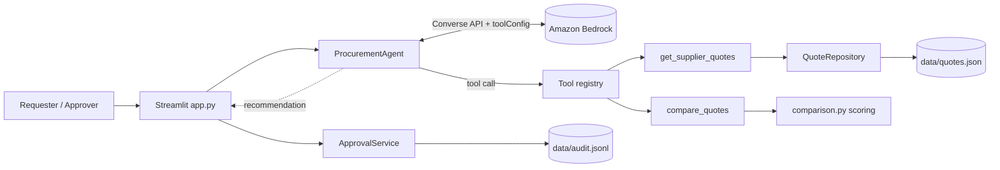

# Intelligent Procurement Agent: Hackathon Architecture

> This describes the current local build. The proposed AWS target architecture, following the AgentCore end-to-end blueprint, is in [architecture/agentcore-design.md](architecture/agentcore-design.md).

Target: 4 hours, one developer. Python 3.11, Amazon Bedrock (Converse API), Streamlit, JSON quote file.

## 1. Design principles

1. **LLM understands and explains. Python decides and enforces.** The model extracts fields, chooses tools and writes the explanation. Ranking math and the approval gate are plain Python, so they are testable and cannot be talked around.
2. **No purchase tool exists.** The model has no way to confirm a purchase. Only the approval service, called from a Streamlit button, can do that.
3. **LLM behind an interface.** Tests use a fake client, so everything except the Bedrock call runs offline.
4. **No database.** Quotes are read from JSON. Requests and decisions are appended to a JSON-lines audit file.

## 2. Architecture diagram



## 3. Flow

1. User types a request. Agent calls Bedrock with a forced `extract_request` tool, which returns product, quantity and required date as structured data.
2. UI shows the extracted values. User confirms or edits. Missing fields trigger a clarification message.
3. Agent runs a tool loop: model calls `get_supplier_quotes`, then `compare_quotes`, then writes the explanation from the tool results.
4. `Recommendation` object (ranked table, winner, explanation, warnings) is shown.
5. Approver clicks Approve or Reject. `ApprovalService` checks role and self-approval, then records the decision. Only after approval is the purchase status "CONFIRMED".

## 4. Components

| Component | File | Responsibility |
|---|---|---|
| Models | `models.py` | Dataclasses: `PurchaseRequest`, `Quote`, `ScoredQuote`, `Comparison`, `Recommendation`, `Decision` |
| QuoteRepository | `quotes.py` | Load JSON, filter by product, drop expired quotes, compute total price and delivery date |
| Comparison | `comparison.py` | Eligibility, normalization, weighted score, tie-breaks, late flags |
| Tools | `tools.py` | Tool JSON specs (Bedrock format) and a dispatcher `run_tool(name, args)` |
| LLM client | `llm.py` | `LLMClient` protocol, `BedrockClient` (boto3 `converse`) |
| Agent | `agent.py` | `extract_request()` and `recommend()` with bounded tool loop |
| ApprovalService | `approval.py` | State machine, role checks, audit log |
| UI | `app.py`, `ui.py` | `app.py` wires real objects; `ui.py` holds the Streamlit screens |

## 5. Project structure

```
procurement_agent/
  app.py
  requirements.txt
  README.md
  data/
    quotes.json
  src/procurement/
    __init__.py
    models.py
    quotes.py
    comparison.py
    tools.py
    llm.py
    agent.py
    approval.py
    ui.py            # Streamlit screens, injectable for tests
  tests/
    conftest.py
    test_quotes.py
    test_comparison.py
    test_tools.py
    test_agent.py
    test_approval.py
    test_ui.py
    fakes.py
```

## 6. Data

`quotes.json` (one entry per supplier quote):

```json
{
  "supplier": "Acme Supplies",
  "product": "laptop",
  "unit_price": 950.0,
  "currency": "USD",
  "lead_time_days": 10,
  "valid_until": "2026-12-31",
  "quote_ref": "ACM-1001"
}
```

Delivery date = request date + `lead_time_days`. Total = `unit_price x quantity`. Product matching is a case-insensitive match on a normalized name plus a small alias list.

## 7. Tool definitions and interfaces

Tool specs use the Bedrock Converse `toolSpec` format.

### 7.1 `extract_request` (forced on step 1)
Input:
```json
{"product": "string", "quantity": "integer", "required_date": "YYYY-MM-DD", "missing": ["string"]}
```
`product`, `quantity`, `required_date` are optional. Unknown fields go in `missing`. The prompt includes today's date so relative dates resolve correctly. Python validates the result (quantity > 0, date not in the past).

### 7.2 `get_supplier_quotes`
Input: `{"product": "string", "quantity": "integer"}`
Output:
```json
{"quotes": [{"supplier": "...", "quote_ref": "...", "unit_price": 0, "total_price": 0,
             "currency": "USD", "lead_time_days": 0, "delivery_date": "YYYY-MM-DD"}],
 "excluded": [{"supplier": "...", "reason": "expired"}]}
```

### 7.3 `compare_quotes`
Input: `{"required_date": "YYYY-MM-DD", "price_weight": 0.6, "delivery_weight": 0.4}`

The tool scores the quotes stored by the last `get_supplier_quotes` call. The model does not pass quotes back in, so it cannot change prices or dates between the two calls.
Output:
```json
{"ranked": [{"supplier": "...", "total_price": 0, "delivery_date": "...", "days_late": 0,
             "eligible": true, "score": 0.0}],
 "recommended": "supplier name or null",
 "warnings": ["..."]}
```

### 7.4 Python interfaces

```python
class QuoteRepository:
    def find(self, product: str, quantity: int, today: date) -> tuple[list[Quote], list[dict]]: ...

def compare(quotes: list[Quote], required_date: date,
            price_weight: float = 0.6, delivery_weight: float = 0.4) -> Comparison: ...

class LLMClient(Protocol):
    def converse(self, system: str, messages: list[dict], tools: list[dict] | None,
                 force_tool: str | None = None) -> dict: ...   # Bedrock Converse-shaped response

class ProcurementAgent:
    def extract_request(self, text: str, today: date, requester: str = "") -> ExtractionResult: ...  # request or missing/errors
    def recommend(self, request: PurchaseRequest, today: date) -> Recommendation: ...

class ApprovalService:
    def submit(self, rec: Recommendation, submitted_by: str) -> str: ...        # returns case id
    def decide(self, case_id: str, user: User, approve: bool, comment: str,
               chosen_supplier: str | None = None) -> Decision: ...
```

## 8. Scoring (from requirements section 9)

1. Eligible = delivery_date <= required_date.
2. Among eligible quotes, price score = (max - price) / (max - min) x 100 and delivery score likewise; if max == min the score is 100.
3. Score = 0.6 x price + 0.4 x delivery. Ties: earlier delivery, then lower price.
4. If none are eligible: rank by days late, then price, and add a warning.

## 9. Approval workflow

States: `PENDING_APPROVAL -> APPROVED -> PO_ISSUED`, or `PENDING_APPROVAL -> REJECTED`. On approval, `ApprovalService` calls a `PurchaseOrderIssuer` (`po.py`). The file issuer writes `data/purchase_orders/PO-YYYY-NNNN.pdf` (the document sent to the supplier) and `.json` (the record). If issuing fails, the case stays APPROVED and an approver can retry; a case never gets two POs. Rules: requester cannot approve their own case, only role `approver` may decide, a decision is final, a rejection needs a comment, choosing a non-recommended supplier needs a comment, and expired quotes block approval. Each transition appends a line to `audit.jsonl`.

## 10. Configuration

Environment variables: `AWS_REGION`, `BEDROCK_MODEL_ID` (any Converse-capable model with tool use), `QUOTES_PATH`, `AUDIT_PATH`. Credentials come from the standard AWS chain.

## 11. Implementation tasks (about 4 hours)

| # | Task | Est. | Validation |
|---|---|---|---|
| T1 | Scaffold, models, sample `quotes.json`, deps | 20 min | Import test, JSON loads |
| T2 | QuoteRepository | 25 min | `test_quotes.py` |
| T3 | Comparison engine | 35 min | `test_comparison.py` |
| T4 | Tool specs and dispatcher | 25 min | `test_tools.py` |
| T5 | LLM client and agent (extract + tool loop) with fake client | 50 min | `test_agent.py`, one live Bedrock smoke call |
| T6 | ApprovalService and audit log | 30 min | `test_approval.py` |
| T7 | Streamlit UI | 40 min | Manual run, Streamlit AppTest |
| T8 | README and demo script | 15 min | Demo walk-through |

## 12. Test cases

**Quotes (T2)**
- Q1 matches product case-insensitively and by alias ("laptops" matches laptop).
- Q2 expired quotes are excluded and reported.
- Q3 total price = unit price x quantity; delivery date = today + lead time.
- Q4 unknown product returns empty list.

**Comparison (T3)**
- C1 cheapest on-time supplier wins when delivery is equal.
- C2 cheapest but late supplier loses to an on-time one.
- C3 no supplier on time: closest wins and a warning is present.
- C4 equal score: earlier delivery wins, then lower price.
- C5 single quote: it is recommended with score 100.
- C6 empty input: no recommendation, warning present.
- C7 weights not summing to 1 are rejected.

**Tools (T4)**
- T-1 each spec has name, description and valid input schema.
- T-2 dispatcher routes by name and returns JSON-serializable output.
- T-3 unknown tool or bad arguments return an error result and do not raise.

**Agent (T5, fake LLM)**
- A1 extraction returns a validated `PurchaseRequest`.
- A2 missing quantity or date is reported, not guessed.
- A3 past date and quantity <= 0 are rejected.
- A4 tool loop executes `get_supplier_quotes` then `compare_quotes` and returns the explanation.
- A5 loop stops after the max iteration count.
- A6 the recommended supplier in the result comes from `compare_quotes` output, not model text.

**Approval (T6)**
- P1 approve by an approver changes state to APPROVED and writes an audit line.
- P2 requester cannot approve own case.
- P3 non-approver is refused.
- P4 reject without a comment is refused.
- P5 second decision on a decided case is refused.
- P6 choosing a different supplier requires a comment.
- P7 expired quote blocks approval.

**UI (T7)**
- U1 Approve button is not shown to the requester role.
- U2 No purchase status is shown as confirmed before approval.

## 13. Risks and shortcuts

- Bedrock model access must be enabled in the account and region beforehand.
- Date extraction can drift, so the user confirms values before quotes are fetched.
- The UI role selector stands in for real authentication in the hackathon.
